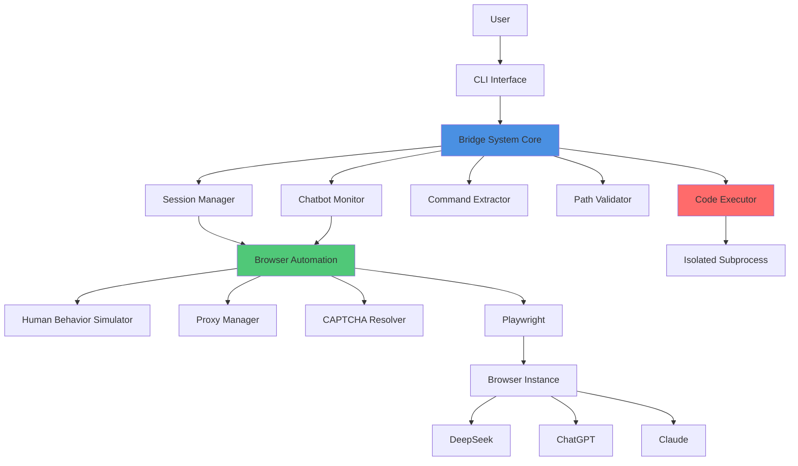
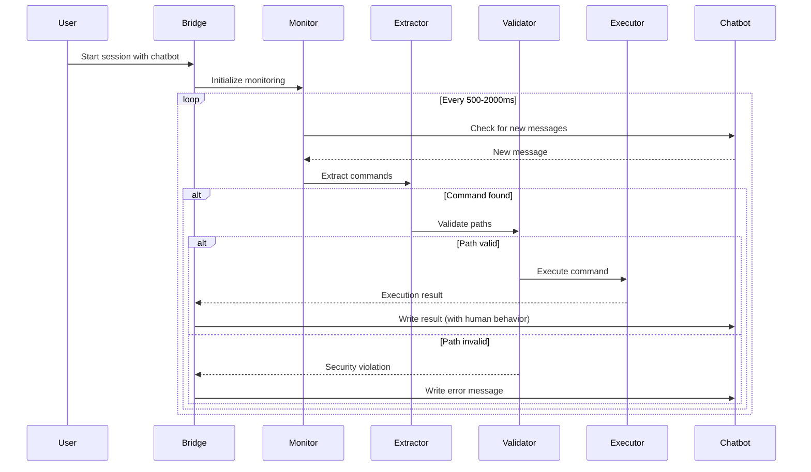

# Design Document: Chatbot Bridge Automation

## Overview

The Chatbot Bridge Automation system transforms free chatbot interfaces (DeepSeek, ChatGPT, Claude) into fully-functional APIs by monitoring conversations, extracting programming commands, and executing them safely on the local machine. The system employs human behavior simulation to avoid detection and blocking.

### Core Objectives

- Monitor chatbot conversations in real-time and extract executable commands
- Execute code safely within a sandboxed environment with resource limits
- Simulate human behavior to avoid detection by anti-bot systems
- Support multiple chatbot platforms simultaneously through a plugin architecture
- Maintain persistent browser sessions to avoid repeated authentication
- Handle errors gracefully with retry logic and adaptive behavior

### Key Design Principles

1. **Security First**: All file operations are restricted to PROJECT_ROOT, and code execution is sandboxed with resource limits
2. **Stealth Operation**: Human behavior simulation at every interaction point to avoid detection
3. **Extensibility**: Plugin architecture allows easy addition of new chatbot platforms
4. **Resilience**: Comprehensive error handling with retry logic and adaptive timeouts
5. **Observability**: Detailed logging of all operations for debugging and monitoring

## Architecture

### High-Level Architecture



### Component Interaction Flow



### Layer Architecture

The system is organized into four distinct layers:

1. **Interface Layer**: CLI and API interfaces for user interaction
2. **Core Logic Layer**: Command extraction, validation, and execution orchestration
3. **Browser Automation Layer**: Playwright-based browser control with stealth features
4. **Execution Layer**: Sandboxed code execution with resource limits

## Components and Interfaces

### 1. Browser Automation Component

**Responsibility**: Manages browser instances using Playwright with stealth features to avoid detection.

```python
class BrowserAutomation:
    """
    Handles all browser automation using Playwright with anti-detection measures.
    """
    
    def __init__(
        self,
        headless: bool = False,
        user_agent: Optional[str] = None,
        proxy_manager: Optional[ProxyManager] = None
    ):
        """
        Initialize browser automation.
        
        Args:
            headless: Whether to run browser in headless mode
            user_agent: Custom user agent string (random if None)
            proxy_manager: Optional proxy manager for rotating proxies
        """
        pass
    
    async def launch_browser(self, profile_path: Optional[str] = None) -> Browser:
        """
        Launch browser with stealth configuration.
        
        Args:
            profile_path: Path to browser profile for session persistence
            
        Returns:
            Playwright Browser instance
        """
        pass
    
    async def hide_automation_flags(self, page: Page) -> None:
        """
        Inject JavaScript to hide automation detection flags.
        
        Args:
            page: Playwright page instance
        """
        pass
    
    async def find_element(
        self,
        page: Page,
        selectors: List[str],
        timeout: int = 30000
    ) -> Optional[ElementHandle]:
        """
        Find element using multiple selector strategies with fallback.
        
        Args:
            page: Playwright page instance
            selectors: List of selectors to try (CSS, XPath, text, ARIA)
            timeout: Maximum wait time in milliseconds
            
        Returns:
            Element handle if found, None otherwise
        """
        pass
    
    async def take_diagnostic_screenshot(
        self,
        page: Page,
        reason: str
    ) -> str:
        """
        Take screenshot for debugging when element detection fails.
        
        Args:
            page: Playwright page instance
            reason: Reason for taking screenshot
            
        Returns:
            Path to saved screenshot
        """
        pass
```

### 2. Session Manager Component

**Responsibility**: Manages browser sessions and profiles for persistent authentication.

```python
class SessionManager:
    """
    Manages browser sessions and profiles for multiple chatbots.
    """
    
    def __init__(self, sessions_dir: str = "./sessions"):
        """
        Initialize session manager.
        
        Args:
            sessions_dir: Directory to store browser profiles
        """
        pass
    
    def create_session(
        self,
        chatbot_name: str,
        session_id: Optional[str] = None
    ) -> str:
        """
        Create new browser session profile.
        
        Args:
            chatbot_name: Name of chatbot (deepseek, chatgpt, claude)
            session_id: Optional custom session ID
            
        Returns:
            Path to session profile directory
        """
        pass
    
    def load_session(self, chatbot_name: str, session_id: str) -> Optional[str]:
        """
        Load existing session profile.
        
        Args:
            chatbot_name: Name of chatbot
            session_id: Session ID to load
            
        Returns:
            Path to session profile directory if exists, None otherwise
        """
        pass
    
    def list_sessions(self, chatbot_name: Optional[str] = None) -> List[Dict[str, Any]]:
        """
        List all available sessions.
        
        Args:
            chatbot_name: Filter by chatbot name (all if None)
            
        Returns:
            List of session metadata dictionaries
        """
        pass
    
    def delete_session(self, chatbot_name: str, session_id: str) -> bool:
        """
        Delete session profile.
        
        Args:
            chatbot_name: Name of chatbot
            session_id: Session ID to delete
            
        Returns:
            True if deleted successfully, False otherwise
        """
        pass
```

### 3. Chatbot Monitor Component

**Responsibility**: Continuously monitors chatbot conversations for new messages.

```python
class ChatbotMonitor:
    """
    Monitors chatbot conversations and detects new messages.
    """
    
    def __init__(
        self,
        page: Page,
        chatbot_plugin: ChatbotPlugin,
        check_interval_range: Tuple[int, int] = (500, 2000)
    ):
        """
        Initialize chatbot monitor.
        
        Args:
            page: Playwright page instance
            chatbot_plugin: Plugin for specific chatbot platform
            check_interval_range: Min and max milliseconds between checks
        """
        pass
    
    async def start_monitoring(
        self,
        on_message_callback: Callable[[str], Awaitable[None]]
    ) -> None:
        """
        Start continuous monitoring loop.
        
        Args:
            on_message_callback: Async callback function for new messages
        """
        pass
    
    async def stop_monitoring(self) -> None:
        """Stop monitoring loop."""
        pass
    
    async def get_latest_message(self) -> Optional[str]:
        """
        Get the latest message from chatbot.
        
        Returns:
            Message text if available, None otherwise
        """
        pass
    
    async def get_conversation_history(self) -> List[Dict[str, str]]:
        """
        Get full conversation history.
        
        Returns:
            List of message dictionaries with 'role' and 'content'
        """
        pass
```

### 4. Command Extractor Component

**Responsibility**: Extracts programming commands from chatbot messages.

```python
@dataclass
class ExtractedCommand:
    """Represents an extracted command from chatbot message."""
    operation_type: str  # create_file, modify_file, delete_file, execute_code, run_command
    file_path: Optional[str]
    code_content: Optional[str]
    language: Optional[str]
    metadata: Dict[str, Any]
    raw_text: str


class CommandExtractor:
    """
    Extracts programming commands from chatbot messages.
    """
    
    def __init__(self, keywords: Optional[List[str]] = None):
        """
        Initialize command extractor.
        
        Args:
            keywords: Custom command keywords (uses defaults if None)
        """
        pass
    
    def extract_commands(self, message: str) -> List[ExtractedCommand]:
        """
        Extract all commands from message text.
        
        Args:
            message: Chatbot message text
            
        Returns:
            List of extracted commands
        """
        pass
    
    def extract_code_blocks(self, message: str) -> List[Dict[str, str]]:
        """
        Extract markdown code blocks from message.
        
        Args:
            message: Message text
            
        Returns:
            List of dicts with 'language' and 'code' keys
        """
        pass
    
    def parse_operation_type(self, text: str) -> Optional[str]:
        """
        Determine operation type from text.
        
        Args:
            text: Command text
            
        Returns:
            Operation type string or None
        """
        pass
    
    def extract_metadata(self, text: str) -> Dict[str, Any]:
        """
        Extract metadata like dependencies, environment variables.
        
        Args:
            text: Command text
            
        Returns:
            Dictionary of metadata
        """
        pass
```

### 5. Path Validator Component

**Responsibility**: Validates file paths for security and ensures operations stay within PROJECT_ROOT.

```python
class PathValidator:
    """
    Validates file paths for security constraints.
    """
    
    def __init__(self, project_root: str):
        """
        Initialize path validator.
        
        Args:
            project_root: Root directory for allowed operations
        """
        pass
    
    def validate_path(self, path: str) -> Tuple[bool, Optional[str], Optional[str]]:
        """
        Validate that path is safe and within project root.
        
        Args:
            path: File path to validate (relative or absolute)
            
        Returns:
            Tuple of (is_valid, absolute_path, error_message)
        """
        pass
    
    def is_within_project_root(self, absolute_path: str) -> bool:
        """
        Check if absolute path is within project root.
        
        Args:
            absolute_path: Absolute file path
            
        Returns:
            True if within project root, False otherwise
        """
        pass
    
    def is_system_path(self, absolute_path: str) -> bool:
        """
        Check if path is a sensitive system directory.
        
        Args:
            absolute_path: Absolute file path
            
        Returns:
            True if system path, False otherwise
        """
        pass
    
    def normalize_path(self, path: str) -> str:
        """
        Convert relative path to absolute and resolve symlinks.
        
        Args:
            path: File path
            
        Returns:
            Normalized absolute path
        """
        pass
```

### 6. Code Executor Component

**Responsibility**: Executes code safely in isolated subprocesses with resource limits.

```python
@dataclass
class ExecutionResult:
    """Result of code execution."""
    success: bool
    stdout: str
    stderr: str
    exit_code: int
    execution_time: float
    error_message: Optional[str] = None


class CodeExecutor:
    """
    Executes code in isolated subprocess with resource limits.
    """
    
    def __init__(
        self,
        timeout: int = 30,
        memory_limit_mb: int = 512,
        cpu_limit_percent: int = 50
    ):
        """
        Initialize code executor.
        
        Args:
            timeout: Maximum execution time in seconds
            memory_limit_mb: Maximum memory usage in MB
            cpu_limit_percent: Maximum CPU usage percentage
        """
        pass
    
    async def execute_code(
        self,
        code: str,
        language: str,
        working_dir: Optional[str] = None,
        env_vars: Optional[Dict[str, str]] = None
    ) -> ExecutionResult:
        """
        Execute code in isolated subprocess.
        
        Args:
            code: Code to execute
            language: Programming language (python, javascript, bash, etc.)
            working_dir: Working directory for execution
            env_vars: Environment variables
            
        Returns:
            ExecutionResult with output and status
        """
        pass
    
    async def execute_file(
        self,
        file_path: str,
        args: Optional[List[str]] = None
    ) -> ExecutionResult:
        """
        Execute a file.
        
        Args:
            file_path: Path to file to execute
            args: Command line arguments
            
        Returns:
            ExecutionResult with output and status
        """
        pass
    
    def _apply_resource_limits(self, process: subprocess.Popen) -> None:
        """
        Apply resource limits to subprocess.
        
        Args:
            process: Subprocess instance
        """
        pass
```

### 7. Human Behavior Simulator Component

**Responsibility**: Simulates human-like interactions to avoid detection.

```python
class HumanBehaviorSimulator:
    """
    Simulates human behavior for browser interactions.
    """
    
    def __init__(
        self,
        typing_delay_range: Tuple[int, int] = (50, 150),
        typo_rate: float = 0.02,
        pause_range: Tuple[int, int] = (500, 3000)
    ):
        """
        Initialize human behavior simulator.
        
        Args:
            typing_delay_range: Min and max ms between keystrokes
            typo_rate: Probability of typing error (0.0 to 1.0)
            pause_range: Min and max ms for random pauses
        """
        pass
    
    async def type_text(
        self,
        page: Page,
        selector: str,
        text: str
    ) -> None:
        """
        Type text with human-like delays and occasional typos.
        
        Args:
            page: Playwright page instance
            selector: Element selector
            text: Text to type
        """
        pass
    
    async def move_mouse(
        self,
        page: Page,
        target_x: int,
        target_y: int,
        steps: int = 20
    ) -> None:
        """
        Move mouse using bezier curve for natural movement.
        
        Args:
            page: Playwright page instance
            target_x: Target X coordinate
            target_y: Target Y coordinate
            steps: Number of intermediate points
        """
        pass
    
    async def scroll_naturally(
        self,
        page: Page,
        distance: int
    ) -> None:
        """
        Scroll page with natural human-like behavior.
        
        Args:
            page: Playwright page instance
            distance: Scroll distance in pixels
        """
        pass
    
    async def random_pause(self) -> None:
        """Add random pause between actions."""
        pass
    
    def _generate_bezier_curve(
        self,
        start: Tuple[int, int],
        end: Tuple[int, int],
        steps: int
    ) -> List[Tuple[int, int]]:
        """
        Generate bezier curve points for mouse movement.
        
        Args:
            start: Starting coordinates
            end: Ending coordinates
            steps: Number of points
            
        Returns:
            List of coordinate tuples
        """
        pass
```

### 8. CAPTCHA Resolver Component

**Responsibility**: Handles CAPTCHA challenges automatically or manually.

```python
class CAPTCHAResolver:
    """
    Resolves CAPTCHA challenges using 2captcha service or manual intervention.
    """
    
    def __init__(
        self,
        api_key: Optional[str] = None,
        timeout: int = 120
    ):
        """
        Initialize CAPTCHA resolver.
        
        Args:
            api_key: 2captcha API key (manual mode if None)
            timeout: Maximum time to wait for solution in seconds
        """
        pass
    
    async def detect_captcha(self, page: Page) -> Optional[str]:
        """
        Detect if CAPTCHA is present on page.
        
        Args:
            page: Playwright page instance
            
        Returns:
            CAPTCHA type (recaptcha_v2, recaptcha_v3, hcaptcha) or None
        """
        pass
    
    async def solve_captcha(
        self,
        page: Page,
        captcha_type: str,
        max_attempts: int = 3
    ) -> bool:
        """
        Solve CAPTCHA challenge.
        
        Args:
            page: Playwright page instance
            captcha_type: Type of CAPTCHA
            max_attempts: Maximum solution attempts
            
        Returns:
            True if solved successfully, False otherwise
        """
        pass
    
    async def _solve_with_service(
        self,
        page: Page,
        captcha_type: str
    ) -> Optional[str]:
        """
        Solve CAPTCHA using 2captcha service.
        
        Args:
            page: Playwright page instance
            captcha_type: Type of CAPTCHA
            
        Returns:
            Solution token or None
        """
        pass
    
    async def _solve_manually(self, page: Page) -> bool:
        """
        Request manual CAPTCHA solution from user.
        
        Args:
            page: Playwright page instance
            
        Returns:
            True if user solved it, False otherwise
        """
        pass
```

### 9. Proxy Manager Component

**Responsibility**: Manages rotating proxies for avoiding IP-based rate limiting.

```python
@dataclass
class ProxyConfig:
    """Proxy configuration."""
    url: str
    protocol: str  # http, https, socks5
    username: Optional[str] = None
    password: Optional[str] = None
    last_used: Optional[float] = None
    failure_count: int = 0


class ProxyManager:
    """
    Manages rotating proxies with health checking.
    """
    
    def __init__(
        self,
        proxies: List[str],
        rotation_interval: Tuple[int, int] = (10, 20),
        test_timeout: int = 10
    ):
        """
        Initialize proxy manager.
        
        Args:
            proxies: List of proxy URLs
            rotation_interval: Min and max requests before rotation
            test_timeout: Timeout for proxy testing in seconds
        """
        pass
    
    async def get_next_proxy(self) -> Optional[ProxyConfig]:
        """
        Get next proxy in rotation.
        
        Returns:
            ProxyConfig or None if no proxies available
        """
        pass
    
    async def test_proxy(self, proxy: ProxyConfig) -> bool:
        """
        Test if proxy is working.
        
        Args:
            proxy: Proxy configuration
            
        Returns:
            True if proxy works, False otherwise
        """
        pass
    
    def mark_proxy_failed(self, proxy: ProxyConfig) -> None:
        """
        Mark proxy as failed and temporarily remove from rotation.
        
        Args:
            proxy: Proxy configuration
        """
        pass
    
    def should_rotate(self) -> bool:
        """
        Check if it's time to rotate proxy.
        
        Returns:
            True if should rotate, False otherwise
        """
        pass
```

### 10. Chatbot Plugin Interface

**Responsibility**: Defines interface for chatbot-specific implementations.

```python
class ChatbotPlugin(ABC):
    """
    Abstract base class for chatbot platform plugins.
    """
    
    @property
    @abstractmethod
    def name(self) -> str:
        """Chatbot platform name."""
        pass
    
    @property
    @abstractmethod
    def url(self) -> str:
        """Chatbot platform URL."""
        pass
    
    @abstractmethod
    async def navigate_to_chat(self, page: Page) -> None:
        """
        Navigate to chat interface.
        
        Args:
            page: Playwright page instance
        """
        pass
    
    @abstractmethod
    async def get_message_selectors(self) -> List[str]:
        """
        Get selectors for message elements.
        
        Returns:
            List of selectors to try
        """
        pass
    
    @abstractmethod
    async def get_input_selectors(self) -> List[str]:
        """
        Get selectors for input field.
        
        Returns:
            List of selectors to try
        """
        pass
    
    @abstractmethod
    async def send_message(
        self,
        page: Page,
        message: str,
        human_behavior: HumanBehaviorSimulator
    ) -> bool:
        """
        Send message to chatbot.
        
        Args:
            page: Playwright page instance
            message: Message text
            human_behavior: Human behavior simulator
            
        Returns:
            True if sent successfully, False otherwise
        """
        pass
    
    @abstractmethod
    async def wait_for_response(
        self,
        page: Page,
        timeout: int = 60000
    ) -> bool:
        """
        Wait for chatbot response.
        
        Args:
            page: Playwright page instance
            timeout: Maximum wait time in milliseconds
            
        Returns:
            True if response received, False if timeout
        """
        pass
```

### 11. Bridge System Core

**Responsibility**: Orchestrates all components and manages the main workflow.

```python
class BridgeSystem:
    """
    Main orchestrator for the chatbot bridge system.
    """
    
    def __init__(self, config: Dict[str, Any]):
        """
        Initialize bridge system.
        
        Args:
            config: System configuration dictionary
        """
        pass
    
    async def start_session(
        self,
        chatbot_name: str,
        session_id: Optional[str] = None
    ) -> str:
        """
        Start new chatbot session.
        
        Args:
            chatbot_name: Name of chatbot platform
            session_id: Optional existing session ID
            
        Returns:
            Session ID
        """
        pass
    
    async def stop_session(self, session_id: str) -> None:
        """
        Stop active session.
        
        Args:
            session_id: Session ID to stop
        """
        pass
    
    async def process_message(
        self,
        session_id: str,
        message: str
    ) -> List[ExecutionResult]:
        """
        Process chatbot message and execute commands.
        
        Args:
            session_id: Active session ID
            message: Chatbot message
            
        Returns:
            List of execution results
        """
        pass
    
    async def send_result_to_chatbot(
        self,
        session_id: str,
        result: ExecutionResult
    ) -> bool:
        """
        Send execution result back to chatbot.
        
        Args:
            session_id: Active session ID
            result: Execution result
            
        Returns:
            True if sent successfully, False otherwise
        """
        pass
    
    def register_event_hook(
        self,
        event_name: str,
        callback: Callable
    ) -> None:
        """
        Register event hook.
        
        Args:
            event_name: Event name (on_command_detected, on_execution_complete, on_error)
            callback: Callback function
        """
        pass
```

## Data Models

### Command Model

```python
@dataclass
class Command:
    """
    Represents a parsed command from chatbot.
    """
    id: str
    operation_type: str  # create_file, modify_file, delete_file, execute_code, run_command
    file_path: Optional[str]
    code_content: Optional[str]
    language: Optional[str]
    dependencies: List[str]
    environment_variables: Dict[str, str]
    working_directory: Optional[str]
    raw_text: str
    timestamp: float
    
    def to_dict(self) -> Dict[str, Any]:
        """Convert to dictionary."""
        pass
    
    @classmethod
    def from_dict(cls, data: Dict[str, Any]) -> 'Command':
        """Create from dictionary."""
        pass
    
    def validate(self) -> Tuple[bool, Optional[str]]:
        """
        Validate command structure.
        
        Returns:
            Tuple of (is_valid, error_message)
        """
        pass
```

### Session Model

```python
@dataclass
class Session:
    """
    Represents an active chatbot session.
    """
    id: str
    chatbot_name: str
    profile_path: str
    created_at: float
    last_activity: float
    is_active: bool
    conversation_history: List[Dict[str, str]]
    executed_commands: List[str]  # Command IDs
    
    def to_dict(self) -> Dict[str, Any]:
        """Convert to dictionary."""
        pass
    
    @classmethod
    def from_dict(cls, data: Dict[str, Any]) -> 'Session':
        """Create from dictionary."""
        pass
    
    def update_activity(self) -> None:
        """Update last activity timestamp."""
        pass
    
    def add_message(self, role: str, content: str) -> None:
        """
        Add message to conversation history.
        
        Args:
            role: Message role (user, assistant)
            content: Message content
        """
        pass
```

### Execution Result Model

```python
@dataclass
class ExecutionResult:
    """
    Result of command execution.
    """
    command_id: str
    success: bool
    stdout: str
    stderr: str
    exit_code: int
    execution_time: float
    timestamp: float
    error_message: Optional[str] = None
    
    def to_dict(self) -> Dict[str, Any]:
        """Convert to dictionary."""
        pass
    
    @classmethod
    def from_dict(cls, data: Dict[str, Any]) -> 'ExecutionResult':
        """Create from dictionary."""
        pass
    
    def format_for_chatbot(self) -> str:
        """
        Format result as message for chatbot.
        
        Returns:
            Formatted message string
        """
        pass
```

### Configuration Model

```python
@dataclass
class BridgeConfig:
    """
    System configuration.
    """
    project_root: str
    sessions_dir: str
    logs_dir: str
    
    # Browser settings
    headless: bool = False
    user_agent: Optional[str] = None
    
    # Monitoring settings
    check_interval_range: Tuple[int, int] = (500, 2000)
    
    # Execution settings
    execution_timeout: int = 30
    memory_limit_mb: int = 512
    cpu_limit_percent: int = 50
    
    # Human behavior settings
    typing_delay_range: Tuple[int, int] = (50, 150)
    typo_rate: float = 0.02
    pause_range: Tuple[int, int] = (500, 3000)
    response_delay_range: Tuple[int, int] = (1000, 5000)
    
    # CAPTCHA settings
    captcha_api_key: Optional[str] = None
    captcha_timeout: int = 120
    
    # Proxy settings
    proxies: List[str] = field(default_factory=list)
    proxy_rotation_interval: Tuple[int, int] = (10, 20)
    
    # Error handling settings
    max_retries: int = 3
    retry_backoff_factor: float = 2.0
    rate_limit_backoff_factor: float = 2.0
    
    @classmethod
    def from_yaml(cls, path: str) -> 'BridgeConfig':
        """
        Load configuration from YAML file.
        
        Args:
            path: Path to YAML file
            
        Returns:
            BridgeConfig instance
        """
        pass
    
    def to_yaml(self, path: str) -> None:
        """
        Save configuration to YAML file.
        
        Args:
            path: Path to YAML file
        """
        pass
    
    def validate(self) -> Tuple[bool, Optional[str]]:
        """
        Validate configuration.
        
        Returns:
            Tuple of (is_valid, error_message)
        """
        pass
```

